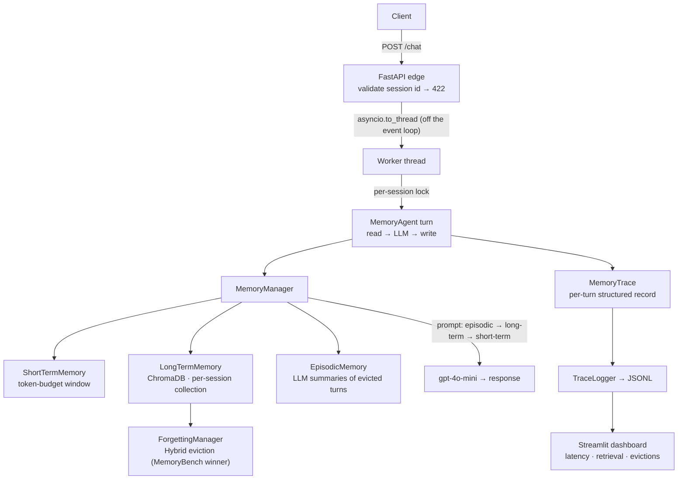
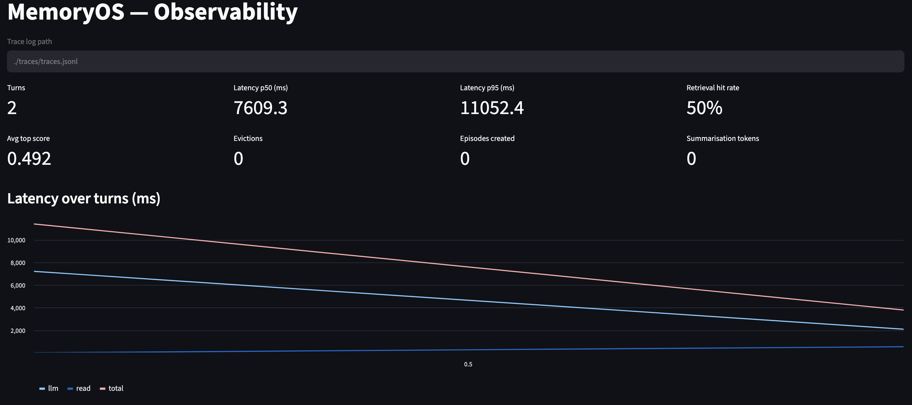
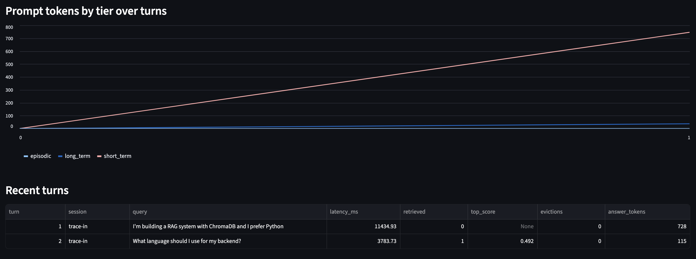

# MemoryOS

> A tiered, observable, concurrency-safe agent memory service — running the forgetting strategy its sibling benchmark proved best.


## Overview

Most LLM agents are stateless — every conversation starts from scratch. The naive fix is to stuff the full history into context, which breaks at scale; the next-naive fix is pure vector retrieval, which loses recent-context fidelity. MemoryOS uses three coordinated tiers — a token-budget sliding window for recent turns, a ChromaDB vector store for long-term semantic retrieval, and an LLM-based episodic layer that *summarises* evicted turns instead of losing them. Each tier handles what the others do badly.

It's built as a **served system**, not a notebook: a FastAPI service with per-session isolation, a thread-safe concurrency model, non-blocking turn execution, a per-turn observability trace, and graceful degradation when a tier fails.

## Benchmarked, then built

MemoryOS is the production half of a two-repo story. Its sibling, **[MemoryBench](https://github.com/sakshi-2606/memorybench)**, benchmarks memory *compression × forgetting* strategies under controlled probes; MemoryOS runs the strategy MemoryBench proved best.

The long-term store forgets by a **Hybrid** policy — retain by a weighted blend of **recency + importance + surprise** (distinctiveness), evicting the lowest-retention memories once the store is over capacity. MemoryBench found this decisively beat FIFO and pure-surprise eviction, which were catastrophic — the wrong forgetting policy is indistinguishable from total memory failure. Rather than guess a policy, MemoryOS serves the measured winner.

## Architecture



A session is the isolation unit: each gets its own ChromaDB collection, and ids are validated at the edge and hashed into collision-proof collection names. One session processes one turn at a time (per-session lock); distinct sessions run concurrently on worker threads, so a slow OpenAI call never blocks the event loop.

## Features

- **Three coordinated memory tiers** — token-budget sliding window, ChromaDB vector store, episodic LLM summaries.
- **Hybrid forgetting** — capacity-based eviction by recency + importance + surprise, ported from MemoryBench's proven-best strategy.
- **Per-turn observability trace** — which tiers were read/written, what was retrieved (with similarity scores), what was evicted and why, and per-stage latency and token counts — persisted as JSONL and rolled up into a Streamlit metrics dashboard (p50/p95 latency, retrieval hit-rate, evictions, drift).
- **Session isolation** — per-session collections, edge validation, and a delete that actually purges — guarded by CI-gated cross-session leakage tests.
- **Concurrency-safe** — thread-safe session registry, per-session turn locks, and non-blocking async turn execution so distinct sessions run in parallel.
- **Graceful degradation** — a failing tier is recorded in the trace and the turn degrades rather than crashing; `/health` (liveness) and `/ready` (readiness) probes.
- **Calibrated retrieval** — similarity threshold tuned from a data sweep; a rule-based noise filter skips filler before it ever hits the embedding API.
- **Tested** — pytest suite + GitHub Actions CI; offline guards gate every PR.

## Observability

Every turn emits a structured `MemoryTrace` — tiers read and written, what was retrieved (with scores), what was evicted and why, per-stage latency and tokens — persisted as JSONL. A Streamlit dashboard rolls these up into operational metrics.





```bash
streamlit run dashboard.py   # observability metrics (shown above)
streamlit run app.py         # interactive memory visualiser
```

## Evaluation

Rather than a single pass/fail score, MemoryOS ships a suite of memory-specific checks that *can* fail — the offline ones run on every PR:

- **Retrieval ranking** — relevant memories must rank above distractors (precision@k, recall).
- **Cross-session isolation** — a fact in one session must never surface in another (offline, CI-gated).
- **Episodic retention** — summarisation must not silently drop facts.
- **Forgetting correctness** — capacity is enforced and the right memories are evicted.

The suite caught, and the codebase then fixed, two real bugs: a turn retrieving its own query (write-before-read ordering), and an over-permissive similarity threshold admitting unrelated memories. The long-term threshold (0.40) is calibrated from data — see `scripts/threshold_sweep.py`.

## Tech Stack

| Component | Tool |
|---|---|
| LLM | OpenAI gpt-4o-mini |
| Embeddings | text-embedding-3-small |
| Vector DB | ChromaDB |
| API | FastAPI + Uvicorn |
| UI / Dashboard | Streamlit |
| Language | Python 3.11 |

## Getting Started

### Prerequisites
- Python 3.11+
- OpenAI API key

### Installation
```bash
git clone https://github.com/sakshi-2606/memoryos.git
cd memoryos
python -m venv .venv && source .venv/bin/activate
pip install -e .
pip install -r requirements.txt
cp .env.example .env   # add your OpenAI API key
```

### Run the FastAPI server
```bash
python -m uvicorn src.memoryos.api:app --reload --port 8000
# API docs at http://localhost:8000/docs
```

### Run the tests
```bash
pytest -m "not integration"   # fast offline suite, no API key
pytest                        # full suite incl. live-API eval (needs OPENAI_API_KEY)
```

## Project Structure
```
memoryos/
├── src/memoryos/
│   ├── api.py              # FastAPI app — /chat, /memory, /health, /ready
│   ├── agent.py            # Stateful turn loop (read → LLM → write) + trace assembly
│   ├── config.py           # Typed config for every tier
│   ├── session_store.py    # Session registry — thread-safe, per-session locks
│   ├── session_id.py       # Session-id validation + collision-proof collection naming
│   ├── observability.py    # Per-turn trace sink (JSONL)
│   ├── metrics.py          # Metrics aggregation over the trace log
│   ├── memeval.py          # Eval dataset loader
│   └── memory/
│       ├── short_term.py   # Token-budget sliding window
│       ├── long_term.py    # ChromaDB vector store + forgetting
│       ├── episodic.py     # LLM summarisation of evicted turns
│       ├── forgetting.py   # Hybrid / FIFO / importance / surprise eviction (MemoryBench port)
│       ├── trace.py        # Per-turn MemoryTrace schema
│       └── manager.py      # Tier coordinator
├── app.py                  # Streamlit memory visualiser
├── dashboard.py            # Streamlit observability dashboard
├── scripts/                # threshold_sweep.py — retrieval threshold calibration
├── tests/                  # offline guards + integration evals
├── .env.example
└── requirements.txt
```

## Roadmap

- [x] Token-based eviction (replaces turn-count window)
- [x] Hybrid forgetting — MemoryBench's proven-best strategy
- [x] Concurrency-safe session store with per-session locks
- [x] Async, non-blocking turn execution
- [ ] Redis-backed session store for multi-instance deployment
- [ ] Local embedding model option (sentence-transformers)
- [ ] Prometheus / Grafana export for ops metrics